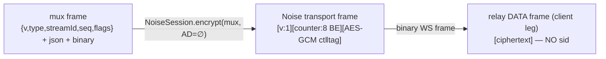
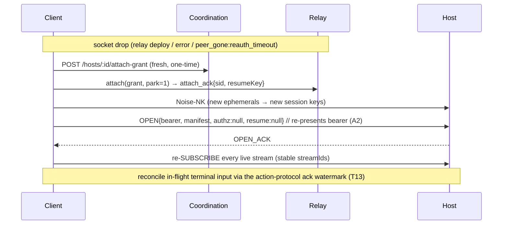
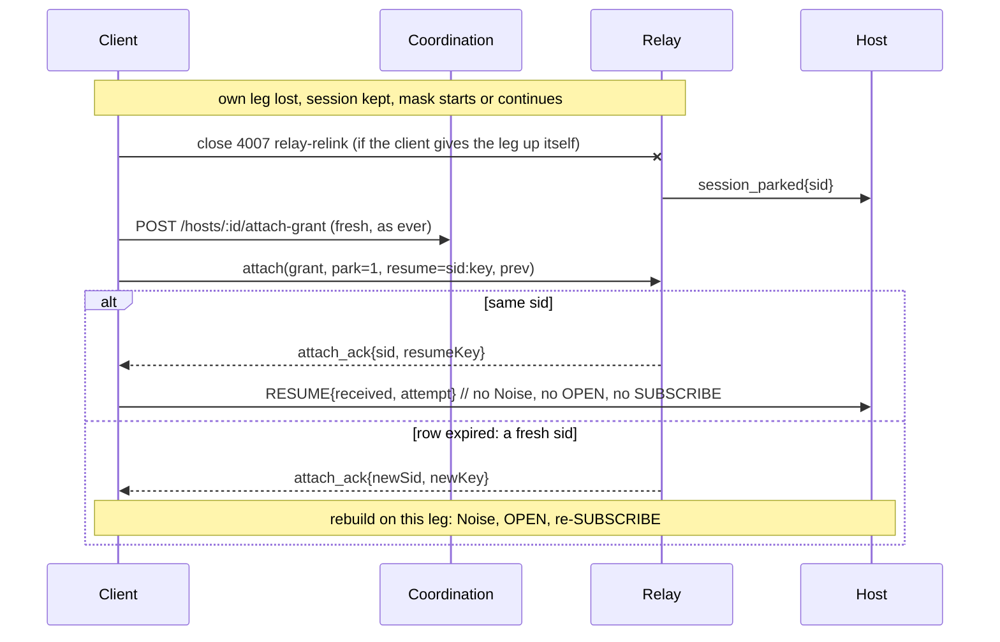

# Client↔host remote transport — mux wire contract (T12)

The client remote transport (`clients/shared/host-transport/remote/`) speaks a
persistent, end-to-end-encrypted, multiplexed session to the host through the
relay. **This document is the source of truth the T11 host responder builds to**
— it mirrors how `workers/relay-do/README.md` documents the relay leg. The
machine-checkable form of everything here lives in
`@traycer/protocol/host-transport/mux`, and the session core that speaks it in
`protocol/src/host-transport/remote/`.

Governs Architecture **§3** (mux/transport), **§9** (client rows). Carries
**R4-E3** (full attach as the fallback recovery path), **R4-A2** (bridging-never-identity), **R4-D1**
(reserved authz slot), **R4-D2** (peer-enforce host standing).

> Status: client transport implemented in T12. The host responder (T11) is
> dispatched after this and MUST match the framing below. Points still to
> reconcile at integration are called out inline as **⚠️ reconcile**.

## 1. Three concentric framings

Only the outermost is relay-visible. Everything below the Noise layer is
ciphertext to the relay.



| Layer                      | Owner                            | Bytes on the client leg                                                        | Who sees it   |
| -------------------------- | -------------------------------- | ------------------------------------------------------------------------------ | ------------- |
| Relay frame (T10)          | relay                            | `[ciphertext]` (binary WS) — **no `sid`**; the relay knows this socket's `sid` | relay + peers |
| Noise transport frame (T8) | `@traycer/protocol/crypto/noise` | `[v:1][counter:8 BE][AES-GCM ct‖tag]`                                          | peers only    |
| Mux frame (T12, this doc)  | client + host                    | `{v,type,streamId,seq,flags}` + `[jsonLen][json][binary]`                      | peers only    |

The architecture's `{v, sid, streamId, seq}` conflates layers 1 and 3: **`sid`
lives at the relay frame layer** (host-leg `[sid]` prefix — see relay README),
**`{v, streamId, seq}` at the mux layer**. The client omits `sid` on-wire
because its single socket is its single session. The host learns each frame's
`sid` from its relay uplink (`[sid][ciphertext]`), demultiplexes to that client's
Noise session, then reads the mux `streamId` inside.

**Associated data is empty (∅) on both legs.** The relay owns/stamps `sid`, so
there is no outer routing metadata to bind; the Noise monotonic counter + replay
window already defeat replay. T11's responder MUST call `encrypt`/`decrypt` with
an empty AD.

## 2. Noise-NK handshake

Suite `Noise_NK_25519_AESGCM_SHA256` (T8). The client is the **initiator**
(anonymous at the Noise layer); the host is the **responder**, authenticated by
its registry-published static X25519 key.

- **Prologue** (mixed into both sides' handshake hash, MUST match byte-for-byte):
  `NOISE_PROLOGUE = utf8("traycer-remote-host/mux/v1")`.
- **Host static key**: the client reads it from the `GET /hosts` DTO
  `publicKey` field and decodes hex **or** base64/base64url to 32 bytes
  (`decodeHostPublicKey`). **⚠️ reconcile** the exact publish encoding with
  the transport and resolver layers.
- **Messages** (2, carried as opaque relay DATA binary frames):
  1. client → host `msg0` (`e, es`)
  2. host → client `msg1` (`e, ee`)
- After `msg1`, both derive `NoiseSession` (`fromHandshake`, replay window
  `DEFAULT_REPLAY_WINDOW_SIZE`). All subsequent DATA frames are Noise transport
  frames wrapping mux frames.

A **fresh Noise session is built per session**, so per full attach — forward
secrecy per session. A resume (§9) keeps the session, and with it its Noise
channel: no handshake runs, and frames resent after one are sealed again under
fresh counters.

## 3. Mux frame binary layout

Fixed 15-byte header, big-endian:

```
[0]      v         uint8    mux protocol version (=1)
[1]      type      uint8    MuxFrameType
[2..6)   streamId  uint32   0 = session control; ≥1 = logical stream
[6..10)  seq       uint32   per-stream monotonic (FIFO / reconcile watermark)
[10]     flags     uint8    bit0 HAS_BINARY · bit1 BULK · bit2 CHUNKED · bit3 CHUNK_LAST
[11..15) jsonLen   uint32
[15..15+jsonLen)   json     utf8 (0-length on a pure continuation chunk)
[15+jsonLen..)     binary   the paired payload / chunk slice
```

### Frame types (`type`)

| Value | Name                | streamId | Payload (json)                                                                                                                          |
| ----- | ------------------- | -------- | --------------------------------------------------------------------------------------------------------------------------------------- |
| 1     | `OPEN`              | 0        | `{muxVersion, bearer, manifest, authz, resume}`                                                                                         |
| 2     | `OPEN_ACK`          | 0        | `{manifest, capabilities}`                                                                                                              |
| 3     | `REQUEST`           | ≥1       | `{requestId, method, schemaVersion, params, idempotencyKey}`                                                                            |
| 4     | `RESPONSE`          | ≥1       | `{requestId, method, result, error}`                                                                                                    |
| 5     | `SUBSCRIBE`         | ≥1       | `{method, schemaVersion, params}`                                                                                                       |
| 6     | `STREAM_FRAME`      | ≥1       | the stream envelope `{kind, hasBinaryPayload, …}` + binary                                                                              |
| 7     | `CLOSE`             | ≥1       | `{reason}`                                                                                                                              |
| 8     | `FATAL`             | 0 or ≥1  | `{details}` (`FatalErrorDetails`; streamId 0 = whole session)                                                                           |
| 9     | `CREDIT`            | 0        | `{credits}` (bulk send-window replenish)                                                                                                |
| 10    | `REAUTH_NOTICE`     | 0        | `{standingUntil}` — host-standing evidence (R4-D2)                                                                                      |
| 11    | `RESUME`            | 0        | `{received, attempt}` — always `seq` 0, unchunked and uncompressed; see §9                                                              |
| 12    | `CREDENTIAL_UPDATE` | 0        | `{bearer, memberCredential}` — in-place bearer rotation, or a team host's member credential with `bearer: null` (each capability-gated) |

`streamId` allocation: the client allocates monotonically from 1. A **subscribe
streamId is stable for the subscription's life across full attaches**; a **unary
streamId is ephemeral** (freed when its `RESPONSE` arrives). On a full attach the
client re-sends `SUBSCRIBE` on the same streamId, so the host re-learns
`streamId → subscription` from the frames. A resume sends no `SUBSCRIBE`: the
host still holds the subscription.

## 4. Session open / ack (identity, R4-A2 / R4-D1)

`OPEN` (streamId 0) is sent immediately after the Noise handshake, **so again on
every full attach**. A resume sends none, because the session it continues is
already authenticated:

```jsonc
{
  "muxVersion": 1,
  "bearer": "<user JWS>",          // R4-A2: re-presented on every full attach
  "manifest": {                     // see "Manifest shape" below - all three keys REQUIRED
    "rpc": { …ConnectionManifest… },         // released floor ONLY
    "optionalRpc": { …ConnectionManifest… }, // every non-floor method
    "stream": { …ConnectionManifest… }
  },
  "authz": null,                    // R4-D1 RESERVED: versioned session-grant slot (team hosts, v3)
  "resume": null                    // R4-E3 RESERVED: always null (the RESUME frame is §9, not this slot)
}
```

- **Bridging-never-identity (R4-A2).** The attach grant authorizes relay
  _bridging_ only. A fresh Noise session is **not** an authenticated session
  until `OPEN` re-presents the `bearer`. The host MUST verify the bearer
  (JWKS + `token.id == ownerUserId`) on **every** `OPEN` — a grant, a ticket or
  a relay resume key MUST NEVER restore identity. A key only moves a relay `sid`
  to a new socket; what proves the session is the Noise channel it still holds.
- **Reserved authz slot (R4-D1).** `authz` is always `null` in v1. The host MUST
  accept `null` and ignore any populated slot. It exists so a future
  `session-grant` (own `typ`/`aud`/signing key) enables team hosts without a
  breaking `OPEN` change.
- **Reserved resume descriptor (R4-E3).** `resume` is always `null`. Continuing
  a session does not use it: see `RESUME` in §9.

`OPEN_ACK` (streamId 0):

```jsonc
{
  "manifest": { "rpc": …, "optionalRpc": …, "stream": … },  // same shape as OPEN
  "capabilities": ["credentialUpdate"]         // additive; e.g. in-place bearer rotation
}
```

`SESSION_CAPABILITY_RESUME` (`"session.resume"`) in both peers' capabilities
turns on §9's session continuity; a session without it recovers by full attach
only.

A team host's session-grant session offers `memberCredential` in place of
`credentialUpdate`. The host spends only a member credential the client hands
it after `OPEN_ACK`, so the client mints the member's credential and sends
`CREDENTIAL_UPDATE {bearer: null, memberCredential}` as the first frame after
the ack; the session is not ready, and carries no request or subscription,
until that frame is enqueued. It does the same on every re-attach. A mint that
fails is logged and the session goes on, so the host's own refusal names the
cause.

### Manifest shape (floor / optional split)

`rpc`, `optionalRpc` and `stream` are **all three required** on both frames -
`sessionManifestsSchema` rejects a frame missing any of them, and the session
reconnects rather than proceeding on a manifest it did not understand. An
implementation that emits only `rpc` + `stream` (the pre-split shape) will have
every `OPEN`/`OPEN_ACK` refused.

| Key           | Contents                   | Compat-checked?                                                                                                                            |
| ------------- | -------------------------- | ------------------------------------------------------------------------------------------------------------------------------------------ |
| `rpc`         | the RELEASED FLOOR only    | **Yes** - a mismatch is session-fatal                                                                                                      |
| `optionalRpc` | every non-floor method     | **No** - merged in for version selection, dispatch and capability gating; a peer missing one degrades per the registry's declared strategy |
| `stream`      | all stream methods, merged | per-subscription at subscribe, never session-fatal                                                                                         |

Split the two rpc channels with `splitConnectionManifest(registry,
RELEASED_FLOOR_METHOD_NAMES)`. A host SHOULD narrow `optionalRpc` to methods it
actually has a resolver for (`deriveHostManifest`) - advertising one it cannot
serve makes a client gate the feature ON and then take a 404 instead of its
clean `E_HOST_UNSUPPORTED` degrade. The floor is deliberately NOT filtered: a
floor method without a resolver is a host bug, and hiding it would revive the
fatal equal-set handshake failure.

Version negotiation is amortized: the client runs `checkCompatibility` over the
FLOOR channel at `OPEN_ACK`, then per-stream `checkStreamMethodCompatibility` at
each subscribe, reusing the exact framework helpers the local transports use. A
hard floor incompatibility → session `FATAL{code:"INCOMPATIBLE"}`; an optional
method either side lacks never fatals the session.

## 5. Unary RPC (single-flight, no post-send auto-retry — audit C3)

- One `REQUEST` per call on a fresh streamId; the matching `RESPONSE` (correlated
  by `requestId`) resolves it. `idempotencyKey` is **always null in v1** (reserved
  for later per-method opt-in dedup — no host dedup machinery yet).
- The client rejects with a **retryable** transport error only when the session
  is not yet ready (provably pre-send); once the `REQUEST` is enqueued, any drop
  surfaces as a plain non-retryable error. Exact local parity — the host needs no
  retry/dedup handling.
- With session continuity (§9) a call survives a resume: its `REQUEST` is
  resent if the host missed it and its `RESPONSE` arrives as usual. Readiness
  holds through the mask, so a call made then is queued rather than refused. If
  the session rebuilds, a call whose frame was never sealed is rejected as
  retryable, because it provably went nowhere, and a sealed one fails as above.

## 6. Streams

- `SUBSCRIBE` opens a logical stream; inbound `STREAM_FRAME`s carry the contract
  envelope as json and its payload as the frame binary (adjacency preserved
  inside one frame). Outbound frames while the session is not ready are dropped
  (fire-and-forget parity; the durable channel / CRDT reconciles above). The one
  exception is a `held` stream (§9), whose frames are queued, delivered after
  the gap on a resume and discarded on a rebuild.
- **Shared fate:** a rebuild reconnects ALL streams. The client re-sends every
  live `SUBSCRIBE` after `OPEN_ACK` on a full attach. A resume re-sends none.

## 7. QoS classes, priority scheduling, credits (audit C1/C2)

Two classes, **fixed per stream at creation** (preserves per-stream FIFO — a
stream never splits across the two queues):

| Class             | Frames                                                                  | Scheduling                   | Credit-gated?           | Chunked?                                                 |
| ----------------- | ----------------------------------------------------------------------- | ---------------------------- | ----------------------- | -------------------------------------------------------- |
| `INTERACTIVE` (0) | keystrokes, live output, all control/unary, subscribe streams (default) | preempts bulk; drained first | **no** (must not stall) | large binary still split at 64 KiB, but stays this class |
| `BULK` (1)        | large order-independent transfers (opt-in stream class)                 | yields to interactive        | **yes**                 | yes                                                      |

- **Priority scheduler:** interactive queue is fully drained before the next
  bulk frame; the interactive queue is re-checked between every bulk frame, so a
  keystroke preempts the next bulk chunk — a keystroke never queues behind a
  megabyte frame.
- **Credits:** each bulk frame (each chunk) consumes one **send** credit, and a
  peer grants a fresh batch back via `CREDIT` (streamId 0) as it consumes
  inbound bulk frames. The window is negotiated, so there are two pairings:
  - **Both peers announce `SESSION_CAPABILITY_FINE_CREDITS`** (current):
    `FINE_INITIAL_BULK_SEND_CREDITS` (64) send credits, granting every
    `FINE_INBOUND_CREDIT_GRANT_BATCH` (32) frames — a batch that is half the
    window, so a grant is always in flight before the sender can run dry.
  - **Either peer predates it** (rc.1 clients still in the field): the legacy
    512-credit window, granting every `LEGACY_INBOUND_CREDIT_GRANT_BATCH` (256)
    frames.

  **⚠️ reconcile:** a peer's initial receive window MUST be ≥ the batch size the
  other end grants at for the pairing in force, or the first bootstrap
  deadlocks — that floor compares a frame count against a frame count, so
  body compression cannot move it. `INITIAL_BULK_SEND_CREDITS` remains the
  client's legacy send-window constant; `INBOUND_CREDIT_GRANT_BATCH` was the
  old batch spelling and is now split into
  `FINE_INBOUND_CREDIT_GRANT_BATCH` and `LEGACY_INBOUND_CREDIT_GRANT_BATCH`.

## 8. 64 KiB bulk chunking

`STREAM_FRAME` / `RESPONSE` whose binary exceeds `BULK_CHUNK_SIZE_BYTES` (64 KiB)
is split: every chunk sets `CHUNKED`, only the final sets `CHUNK_LAST`; the json
envelope rides the **first** chunk only, continuation chunks carry empty json.
Per-stream FIFO keeps a message's chunks contiguous, so the receiver reassembles
by accumulating a stream's chunk binaries until `CHUNK_LAST` (`ChunkReassembler`).
Control/session frames are never chunked.

## 9. Recovery: full attach, resume and relink (R4-E3)

There are two ways back from a lost relay leg. A **full attach** builds a new
session and works against any peer. A **resume** keeps the session and continues
it on the same Noise channel, and needs both peers to have negotiated
`session.resume` (§4). A resume that fails falls back to a full attach, which
this document calls a **rebuild**, so a drop that does not heal in time ends
where it always did.

The client separates the two things a connection used to be. The **leg** is the
socket and what is bound to it: the relay's re-auth deadline and the dial
timeouts. The **session** is everything else: the Noise channel, scheduler,
reassembler, credits, manifest, ledger, relay `sid` and resume key. A resume
keeps the session; a rebuild discards both.

### Full attach

A relay deploy drops every socket by documented Cloudflare behavior — treat it as
routine.



- **Backoff resets ONLY at the ready boundary** (transport open · E2E handshake ·
  session open · subscriptions restored), never on socket-open, and only after
  the connection has survived there for `RECONNECT_STABLE_RESET_MS`.
- In-flight unary calls are handled as in §5.
- **Reconcile** of in-flight terminal input rides the terminal action protocol's
  ack watermark — that is **T13**; the mux only guarantees per-stream FIFO +
  re-subscribe and reserves `seq` for the watermark.

Every relay attach carries `grant`, `park=1` and, once a leg has been replaced,
`prev=<code>:<reason>` (telemetry only). The relay's Worker copies a field only
when it is well formed, and records only a fixed set of reasons, so the client
names a reason from that set and otherwise leaves it empty: `prev=1000:`. The code
is what the measurement needs. A malformed field is dropped, never refused, and
a relay that predates a field ignores it.

### Session continuity: the `RESUME` exchange

Each peer keeps a **ledger** from its first transport mux frame: a count of what
it has sent, a count of what it has received, and a ring of up to 5 MiB of sent
frames. `RESUME` frames are in neither. If `OPEN_ACK` does not carry
`session.resume`, the ledger is dropped.

An exchange runs when the client has reason to think the path is back, either a
`host_attached` or the same `sid` in a relink's ack:

1. The client pauses its scheduler and waits for the frames it is still
   decrypting and the write it is still sealing, so `received` is exact and
   nothing overtakes the `RESUME`.
2. It sends `RESUME{received, attempt}`. `attempt` numbers the session's
   exchanges 1, 2, 3 and so on, across legs. From here it decrypts and discards
   every inbound frame without counting it, until a `RESUME` carrying that
   `attempt`. An answer to another attempt is ignored, and so is whatever follows
   it.
3. The host answers `RESUME{received, attempt}` with its own count and the
   client's `attempt`, then resends what the client lacks. A later `RESUME`
   supersedes a replay still running.
4. The matching answer opens inbound. The client trims its ring to the host's
   count and resends the gap ahead of both queues. Resent frames go through the
   pacer, because the relay limits frame rate whatever the frames are, and spend
   no bulk credit, because the first send already did.
5. When the last resent frame is written the pause ends and the session is live.

A second `host_attached` restarts the exchange with the next `attempt`. A
`host_detached` before step 5 cancels it, including a replay already running, and
the session returns to where it was with its original deadlines. The exchange
rebuilds if the answer does not come within `RESUME_ACK_MS` (5 s), if it is
malformed, if the gap is no longer in the ring, or if a session `FATAL` arrives
during the wait.

The host's side of this:

- It holds a negotiated session when its uplink drops or on `session_parked{sid}`,
  for `RESUME_HOLD_MS` from that first drop, and discards inbound uncounted until
  a `RESUME`. A session that did not negotiate is torn down at once. The clock
  stops at `RESUME`, the original deadline stands through the replay, and only a
  completed replay earns a later drop a fresh hold.
- An expired hold closes the session and sends `reset_session`, which the client
  reads as a relay kill and rebuilds on.
- A malformed `RESUME` or a gap past its ring gets a retryable `FATAL`
  (`SESSION_RESUME_UNRECOVERABLE`), which rebuilds the client.
- A `RESUME` arriving on a live session is answered in place: the relay can move a
  `sid` off a client leg the host never saw die.
- `session_opened{sid}` for a sid it holds changes nothing. For one it does not, it
  builds a fresh responder, the client's sealed `RESUME` fails that handshake as
  `stale-session`, and the host sends `reset_session`.
- On its own re-attach the ack's `sessions` and `parked` lists are the truth: a
  held session in neither is closed, and a listed sid it does not hold gets a fresh
  responder, which it does not reset until a first frame proves it stale.

| State       | `isReady()`                  | Meaning                                                                 |
| ----------- | ---------------------------- | ----------------------------------------------------------------------- |
| `live`      | true                         | Traffic flows.                                                          |
| `masked`    | true                         | Host or own leg lost, within `RESUME_MASK_MS` (5 s). Nothing announced. |
| `down`      | false                        | Past the mask. The session is retracted, as on any loss.                |
| `resuming`  | as it was                    | The exchange above; ends live, or on the resumed edge from `down`.      |
| `relinking` | as it was, the mask expiring | No leg; a claim is being dialed.                                        |

Streams tell the truth about all of this through `StreamContinuity`, the fourth
argument of a status change:

- Inside the mask nothing is announced.
- At the mask's end an open stream goes `reconnecting` with `"held"`. Its
  negotiated version stays, and the subscription is not lost: a consumer must not
  reset for a snapshot that will not come. Frames it sends are queued (§6).
- On the resumed edge it goes `open` with `"continued"`, and no `SUBSCRIBE` is
  sent. The edge reports dial success and announces a session under ids of their
  own, because the authority de-duplicates by both.
- When `RESUME_HOLD_MS` (60 s) passes, or on a rebuild, it goes `reconnecting`
  with `null`, the plain contract: expect a reset and a re-subscribe.
- A stream whose subscribe was never answered is not held. It stays `reconnecting`
  and opens with `null` on its first frame.

The local transport never emits `"held"` or `"continued"`.

A host that never returns is no slower to detect: retraction at the mask's end
hands the authority the same evidence as any other loss. A `host_attached` past
the hold rebuilds instead of attempting a `RESUME` that could only fail, and a
hold flip waits for an exchange in progress or a claim being dialed, either of
which can still prove the session alive.

### Own-leg loss: the relink

The relay can **park** a client's session: when a socket that declared `park=1`
closes with 1005, 1006, a socket error or a code from 4000 to 4007 while the host
leg declared it too, the relay keeps the `sid` for 60 s and tells the host
`session_parked{sid}` rather than `session_closed{sid}`. 1000 and 1001 are a
person's action or a deliberate teardown, and close as ever. A killed leg never
parks, a kill of the host leg drops every park because the host tears its held
sessions down with it, and `reset_session` ends the park it names.

`attach_ack{sid, resumeKey}` carries a key for the session's life, 128 random bits
as 22 characters of unpadded base64url, and it is what claims the `sid` back. A
claim's ack repeats the same key. A secret: never log it. It is not an identity
(§4). A relay that sends no key cannot park, so an own-leg loss there is an
ordinary full attach.

A claim matches an unexpired park row, or the leg that still owns the `sid`
because the relay has not seen it die. That leg is superseded: it owns nothing
from then on, and the relay closes it with 1012 when its next frame arrives. A
claim that matches nothing is a fresh attach with a new `sid`, with no error frame
and no close.

With a key in hand and a ready, resume-negotiated session, every loss of the
client's own leg enters `relinking`: a socket close or error, a failed send, a
missed-pong or wake-probe failure, `forceReconnect`, `requestSessionReconnect`, and
the mobile wake path, which calls `forceReconnect`. So `forceReconnect` keeps the
session and replaces only the leg; before ready, or with no key, it drops the
connection and redials.



- **4007 `relay-relink`** is the code for a leg the client gives up while keeping
  the session, because 1000 would end it for good. The socket's own failure codes
  4000 to 4006 are unchanged and park too.
- The dial is today's immediate recovery rung. A dial that fails or never acks
  walks the ordinary ladder and claims again with the same key: the relay may have
  moved the `sid` to a leg whose ack was lost, and only the key takes it back.
- Only a failure of the leg claims again: a socket close or error, a failed send,
  a claim dial's failure, a caller's reconnect. A failure of the session itself
  rebuilds, whichever leg or state it lands in: a frame that will not decrypt or
  decode, or a session `FATAL`. Resuming past one would lose or repeat frames.
- The client always claims. The hold does not apply to its own loss, because
  only the relay's answer can say whether the session is still there. Past the
  relay's 60 s the ack carries a fresh `sid`, which is what a phone back from a
  long background usually sees.
- A fresh `sid` is a full attach on the leg already open. Another dial would cost
  a second grant and attach on the most visible path there is, opening the app.
  The old session is discarded in the ack's own turn, and anything the relay says
  before the new Noise channel exists waits in arrival order.
- Late events from a leg the session has left do nothing. Socket callbacks check
  the leg's identity, not the generation, because a relink keeps the generation.

### Host blip

Without session continuity, a host blip is NOT a resume: a re-attach
RE-HANDSHAKES.

`host_detached` (relay control) → the client **pauses** the scheduler (holding
frames, not losing them to a host-less relay). A resume-negotiated ready session
then takes the mask as above. Any other session marks streams reconnecting.

The same frame is the relay's answer to a client that has **no host to reach**:
it is sent right after `attach_ack` when no host leg is attached, and in reply
to any data frame while that holds. Received before the ready boundary (phase
`handshaking` / `opening`) it clears the phase timer and parks exactly as
above; a repeat while parked is a no-op. The client does **not** redial:
`host_attached` is the one frame that says the host is back. What the phase
timer used to bound, the park bounds itself: a dial refusal is reported at once
and again every handshake-timeout interval while the park lasts (the relay's
word about its own host leg is host-transport-plane evidence; the authority
confirms death on a streak, and this keeps the streak's cadence without an
attach behind each report); parked `sendUnary` callers get the retryable
pre-send failure a refused attach promises; the client re-auth loop is armed so
the relay's 60-min client-leg deadline never sweeps the parked leg; the
host-standing watchdog (§10) a responder frame may have armed is cleared, since
the relay has declared the host absent and the refusal cadence is that
absence's evidence; a Noise responder that completes after the detach does not
open; `forceReconnect` drops the parked leg and redials now. Before
this a client of an offline host attached, sent its Noise initiator, was told
`peer_gone{host_gone}`, backed off 1–30 s and attached again for as long as the
host stayed away — 88,269 attaches a day across 20 hosts on 2026-09-24, each
minting a grant and waking the relay object. Relays no longer emit
`peer_gone{host_gone}`; the reason stays in the enum for older relays.

`host_attached` → a resume-negotiated ready session inside the hold starts the
exchange above. Otherwise **full attach**: fresh `NoiseChannel`, fresh relay
dial, fresh `open{bearer}`. A host without continuity discards every client Noise
session on any uplink close, and the relay emits this frame from exactly one
site — the host's re-attach — so the frame is proof that the responder this
session was built against is gone. That holds whether or not this client ever
saw the matching `host_detached`: a client that missed it is left holding a
channel nothing can answer, and its only other exit is the 15-min standing
watchdog (§10). It holds mid-handshake too, where the rebuild replaces a phase
timeout that would otherwise land as a _refusal_. The loss is reported
`indeterminate`, never a host refusal: the frame says the host is ATTACHED, and
it is the redial's own outcome that speaks about the host.

A `peer_gone`/`killed` and a proven session silence (§11) reach the same full
attach, and so does a socket drop that cannot relink. `peer_gone`/`killed` reason
`revoked` is **terminal**.
`host_gone` / `reauth_timeout` → full attach with ordinary backoff. These two
name the HOST's leg — it left, or it failed to re-present standing — so they are
the only relay kills reported on the `host-transport-plane`, and a handshake
timeout on the redial that follows is a refusal.
`session_reset` (the host asked the relay to drop this client leg because it can
no longer serve the Noise session behind it) → full attach at the ladder's
**current** rung: the host is alive and waiting for a re-handshake.
`policy_violation` and every unknown/future reason → full attach at the capped
backoff rung. `session_reset`, `policy_violation` and the unknown reasons report
an indeterminate relay loss, never a host refusal: they describe the relay's
handling of this leg, not the host's willingness to serve it.

## 10. Re-auth & peer-enforced host standing (R4-D2)

- **Client leg (≤60 min):** the client re-mints a fresh one-time attach grant and
  re-presents it in-band via the relay `reauth{grant}` control frame at
  ~45 min ± jitter, under the relay's 60-min client-leg deadline.
- **Host leg (≤15 min), peer-enforced:** a revoked host will not enforce its own
  death, so the client runs a 15-min **host-standing watchdog**, reset ONLY by
  **in-channel** evidence that the host is alive: a frame through the Noise
  channel (the handshake reply, any established inbound frame, the `OPEN_ACK`),
  including a `REAUTH_NOTICE` mux frame. On lapse the client fails the session
  itself. Relay control frames deliberately do **not** feed it: the relay
  answers keepalives at its own edge and re-announces host attachment on every
  burst, so a client that let those reset the clock would re-arm its own
  watchdog forever against a host that had stopped answering. (A relay
  `host_attached` now rebuilds the session or starts a resume — §9 — and neither
  leaves it to reset; the watchdog is re-armed when a resume completes.)
  **⚠️ reconcile:** T11 SHOULD emit
  `REAUTH_NOTICE{standingUntil}` after each successful relay re-auth so the
  client has an explicit host-standing signal (the future P2P swap turns this
  into a CS-signed assertion); absent it, the client falls back to
  inbound-frame liveness.

## 11. Keepalive, and the on-demand liveness probe

Relay `relay-ping` / `relay-pong` strings only (auto-responded by the relay
without waking the DO). **No E2E idle ping** (R4-C1) — the idle liveness floor is
the re-auth exchange. The client sends `relay-ping` on an interval and drops the
socket on missed pongs.

**The session-silence probe is not a ping.** It is sent ON DEMAND and only when
a symptom has already fired on a session that has been in-channel silent for
`SESSION_SILENCE_TIMEOUT_MS` (20s): a unary timed out, a stream's reassembly
watchdog fired, or a subscribe received no first frame. The session then sends
ONE cheap unary (the desktop client uses `host.status`; the session itself is
registry-agnostic and a composition may pass `null` to make no silence claims
at all) and arms a verdict timer for `SESSION_LIVENESS_PROBE_TIMEOUT_MS` (5s).

**Only the verdict timer decides**, and only on one question: has any
in-channel frame arrived, on any stream, since the probe went out? The probe's
own promise never decides — an answer, an error envelope and a per-stream FATAL
all arrive in-channel and are all counted, while a rejection with the counter
unchanged means the probe was never asked (a method this host does not
advertise, an enqueue that threw) and cancels the verdict instead. A session
that is still silent when the timer fires is dropped `indeterminate` and
redialed. An idle session with nothing outstanding never probes, and neither does
one waiting for its host to come back (§9): that silence has an owner already.

## 12. Reserved / deferred (do not build in v1, keep additive)

| Field / type                   | Reserve  | Why                                                      |
| ------------------------------ | -------- | -------------------------------------------------------- |
| `OPEN.authz`                   | R4-D1    | versioned session-grant slot for team hosts (v3)         |
| `OPEN.resume`                  | R4-E3    | always `null`; session continuity uses `RESUME` (§9)     |
| `REQUEST.idempotencyKey`       | audit C3 | later per-method opt-in dedup                            |
| `CREDENTIAL_UPDATE` capability | —        | in-place bearer rotation; capability-gated on `OPEN_ACK` |
